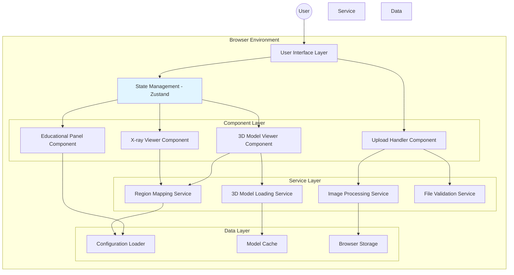
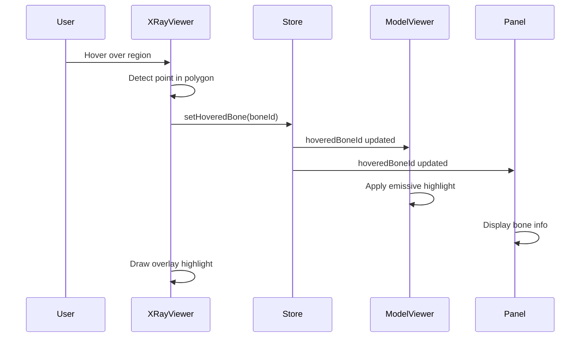
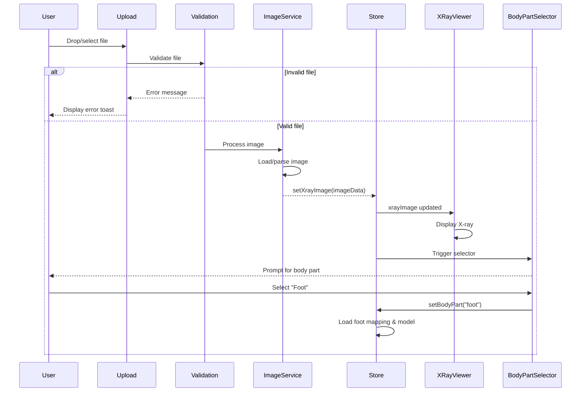

# Design Document

## Overview

BoneVision is a browser-based educational web application that combines X-ray image visualization with interactive 3D anatomical models to bridge the healthcare communication gap between medical professionals and patients. The application enables users to upload X-ray images (initially focusing on foot anatomy) and explore corresponding 3D bone models with synchronized highlighting and educational content delivery.

### Core User Experience Flow

1. **Entry Point**: User lands on the application with two options:
   - **Demo Mode**: Immediately interact with pre-loaded foot X-ray and 3D model
   - **Upload Mode**: Upload their own X-ray image for exploration

2. **Image Display**: X-ray image appears in the left viewport with interactive regions overlaid on anatomical structures

3. **Interactive Exploration**: User hovers over or clicks bones in either the X-ray or 3D view, triggering:
   - Synchronized highlighting in both views
   - Educational content display with bone name, function, and common injuries
   - Camera animation to focus on selected bone in 3D space

4. **3D Manipulation**: User navigates the 3D model using standard controls:
   - Rotate (left-click drag)
   - Zoom (scroll wheel)
   - Pan (right-click drag)

### Technology Stack

**Frontend Framework**: React 18+ with TypeScript for type safety, component architecture, and developer experience

**3D Rendering Engine**: React Three Fiber (R3F) - React renderer for Three.js providing declarative 3D scene composition with React components and hooks

**State Management**: Zustand for lightweight global state management (selected bone, hover states, camera positions)

**Styling**: Tailwind CSS with custom healthcare-themed color palette for rapid UI development and consistent design system

**Build Tool**: Vite for fast development server with Hot Module Replacement (HMR) and optimized production builds

**Key Libraries**:
- `@react-three/fiber` - React renderer for Three.js
- `@react-three/drei` - Helper components and hooks (OrbitControls, useGLTF, Html, etc.)
- `three` - Core 3D graphics library
- `zustand` - State management
- `dicom-parser` or `cornerstone-core` - DICOM image parsing (for DICOM support)
- `react-dropzone` - File upload handling

### Design Principles

1. **Privacy First**: All image processing happens client-side; no data transmission to external servers
2. **Performance**: Maintain 30+ FPS for 3D interactions on modern hardware
3. **Accessibility**: Keyboard navigation, screen reader support, sufficient color contrast
4. **Responsiveness**: Support desktop (1920x1080), laptop (1366x768), and tablet (768x1024) viewports
5. **Educational Focus**: Present medical information in plain language suitable for non-medical users
6. **Progressive Enhancement**: Provide fallback messages for browsers without WebGL support

## Architecture

### System Architecture Diagram



### Architecture Layers

#### 1. User Interface Layer
Top-level React components responsible for layout, routing, and user interaction orchestration.

**Components**:
- `App.tsx` - Root component with routing and layout structure
- `Header.tsx` - Application branding and mode toggle
- `SplitLayout.tsx` - Responsive layout container managing viewport distribution

**Responsibilities**:
- Handle viewport sizing and responsive breakpoints
- Coordinate global UI state (loading indicators, error boundaries)
- Manage keyboard shortcuts and accessibility features

#### 2. State Management Layer
Centralized state using Zustand stores for reactive updates across components.

**Primary Store Structure**:
```typescript
interface BoneVisionStore {
  // Current interaction state
  selectedBoneId: string | null;
  hoveredBoneId: string | null;
  
  // Mode and configuration
  mode: 'demo' | 'upload';
  bodyPart: 'foot' | null;
  
  // X-ray state
  xrayImage: ImageData | null;
  xrayScale: number;
  
  // 3D viewer state
  cameraPosition: [number, number, number];
  cameraTarget: [number, number, number];
  
  // Actions
  setSelectedBone: (id: string | null) => void;
  setHoveredBone: (id: string | null) => void;
  loadXray: (image: File | string) => Promise<void>;
  setBodyPart: (part: string) => void;
  focusBone: (boneId: string) => void;
}
```

**Store Modules**:
- `useBoneVisionStore` - Main application state
- `useEducationalContentStore` - Cached educational content for bones

#### 3. Component Layer

##### X-ray Viewer Component (`XrayViewer.tsx`)
Displays uploaded or demo X-ray images with interactive region overlays.

**Implementation Approach**:
- Base `` element for X-ray display
- Positioned `<canvas>` or `<svg>` overlay for interactive regions
- Canvas chosen for performance with many regions (15+ for foot)
- Event listeners for mouse movement and clicks

**Key Features**:
- Render semi-transparent colored overlays on hover (alpha: 0.3)
- Detect cursor position within polygon regions using point-in-polygon algorithm
- Scale overlay coordinates to match displayed image dimensions
- Display X-ray with aspect ratio preservation using CSS `object-fit: contain`

**Interactive Region Detection**:
```typescript
// Point-in-polygon ray casting algorithm
function isPointInPolygon(point: Point, polygon: Point[]): boolean {
  let inside = false;
  for (let i = 0, j = polygon.length - 1; i < polygon.length; j = i++) {
    const xi = polygon[i].x, yi = polygon[i].y;
    const xj = polygon[j].x, yj = polygon[j].y;
    
    const intersect = ((yi > point.y) !== (yj > point.y))
        && (point.x < (xj - xi) * (point.y - yi) / (yj - yi) + xi);
    if (intersect) inside = !inside;
  }
  return inside;
}
```

##### 3D Model Viewer Component (`ModelViewer.tsx`)
React Three Fiber canvas rendering the 3D bone model with camera controls.

**Implementation Approach**:
- `<Canvas>` component from R3F as the root 3D context
- `<OrbitControls>` from drei for camera manipulation
- Individual bone meshes loaded from GLTF/GLB model
- Material system supporting emissive highlights
- Lighting setup: ambient light + directional light for depth perception

**Scene Structure**:
```typescript
<Canvas camera={{ position: [0, 5, 10], fov: 50 }}>
  <ambientLight intensity={0.5} />
  <directionalLight position={[10, 10, 5]} intensity={1} />
  <OrbitControls
    enablePan={true}
    enableZoom={true}
    enableRotate={true}
    minDistance={5}
    maxDistance={50}
  />
  <BoneModelGroup />
</Canvas>
```

**Bone Highlighting**:
- Store reference to each bone mesh using `useRef`
- On hover/selection, modify material properties:
  - `emissive` color (e.g., `#4488ff`)
  - `emissiveIntensity` (e.g., `0.5`)
- Smooth transitions using `lerp` for material properties

**Camera Animation**:
- Use `useFrame` hook to interpolate camera position and target
- Animation duration: 500ms with easing function
- Focus position calculated from bone bounding box center

##### Educational Panel Component (`EducationalPanel.tsx`)
Displays educational content for the selected or hovered bone.

**Layout**:
- Fixed or floating panel positioned overlay or in a sidebar
- Card-based design with clear visual hierarchy
- Sections: Bone Name (heading), Function (paragraph), Common Injuries (list)

**Content Structure**:
```typescript
interface BoneInfo {
  id: string;
  name: string;
  function: string;
  commonInjuries: string[];
  xrayStatus?: string; // Optional annotation for uploaded X-rays
}
```

**Behavior**:
- Display content immediately on hover (prioritize hover over selection)
- Smooth fade transition when content changes
- Default state: introductory text explaining how to interact with the application

##### Upload Handler Component (`UploadHandler.tsx`)
File input and drag-and-drop interface for X-ray image uploads.

**Implementation Approach**:
- `react-dropzone` for drag-and-drop functionality
- Hidden file input triggered by button click
- Visual drop zone with dashed border and hover state

**Validation Flow**:
1. Check file extension: `.jpg`, `.jpeg`, `.png`, `.dcm`
2. Check file size: max 10MB
3. For DICOM files, parse using `dicom-parser` library
4. Convert to displayable format (extract pixel data, apply window/level)
5. For JPEG/PNG, use browser's native `Image` API
6. Display error toast for validation failures

**File Processing**:
```typescript
async function processUploadedImage(file: File): Promise<ImageData> {
  // Validate file type and size
  if (!isValidFileType(file)) throw new Error("Invalid file format");
  if (file.size > 10 * 1024 * 1024) throw new Error("File too large");
  
  // Process based on file type
  if (file.name.endsWith('.dcm')) {
    return await parseDICOM(file);
  } else {
    return await loadImage(file);
  }
}
```

**Body Part Selector**:
- Modal or dropdown appearing after successful upload
- Initially only "Foot" option available
- Future expansion: hand, knee, spine, etc.

#### 4. Service Layer

##### Image Processing Service (`imageService.ts`)
Handles image loading, format conversion, and display preparation.

**Responsibilities**:
- Load JPEG/PNG images using `FileReader` API
- Parse DICOM files using `dicom-parser` or `cornerstone-core`
- Extract pixel data and apply windowing for DICOM
- Generate thumbnail previews
- Handle image rotation and orientation corrections

**DICOM Processing**:
```typescript
import dicomParser from 'dicom-parser';

async function parseDICOM(file: File): Promise<ImageData> {
  const arrayBuffer = await file.arrayBuffer();
  const byteArray = new Uint8Array(arrayBuffer);
  const dataSet = dicomParser.parseDicom(byteArray);
  
  // Extract pixel data
  const pixelData = dataSet.elements.x7fe00010.dataOffset;
  const width = dataSet.uint16('x00280011');
  const height = dataSet.uint16('x00280010');
  
  // Apply window/level for display
  const windowCenter = dataSet.floatString('x00281050');
  const windowWidth = dataSet.floatString('x00281051');
  
  return processPixelData(pixelData, width, height, windowCenter, windowWidth);
}
```

##### 3D Model Loading Service (`modelService.ts`)
Manages loading and caching of 3D bone models.

**Responsibilities**:
- Load GLTF/GLB models using `useGLTF` hook from drei
- Apply level-of-detail (LOD) optimization for complex models
- Cache loaded models to prevent redundant network requests
- Extract individual bone meshes from model hierarchy
- Apply default materials and prepare for highlighting

**Model Loading**:
```typescript
import { useGLTF } from '@react-three/drei';

function BoneModelGroup() {
  const { scene } = useGLTF('/models/foot-bones.glb');
  
  // Clone scene to avoid shared state issues
  const clonedScene = useMemo(() => scene.clone(), [scene]);
  
  // Extract individual bone meshes
  const boneMeshes = useMemo(() => {
    const meshes: Record<string, THREE.Mesh> = {};
    clonedScene.traverse((child) => {
      if (child instanceof THREE.Mesh) {
        meshes[child.name] = child;
      }
    });
    return meshes;
  }, [clonedScene]);
  
  return <primitive object={clonedScene} />;
}

// Preload in parent component
useGLTF.preload('/models/foot-bones.glb');
```

**Model Optimization**:
- Use Draco compression for GLTF files to reduce file size
- Implement LOD by swapping meshes based on camera distance
- For models exceeding 100k polygons, generate simplified versions

##### Region Mapping Service (`mappingService.ts`)
Provides mapping between X-ray regions and 3D bone meshes.

**Responsibilities**:
- Load mapping configuration from JSON files
- Provide lookup functions: region coordinates → bone ID, bone ID → region coordinates
- Validate mapping consistency (all bones referenced exist in 3D model)
- Support multiple body part configurations

**Mapping Configuration Format**:
```json
{
  "bodyPart": "foot",
  "xrayDimensions": { "width": 1920, "height": 1080 },
  "bones": [
    {
      "id": "calcaneus",
      "name": "Calcaneus (Heel Bone)",
      "function": "The calcaneus is the largest tarsal bone and supports body weight during standing and walking. It serves as the attachment point for the Achilles tendon and several plantar foot muscles.",
      "commonInjuries": [
        "Calcaneal fracture (from high-impact falls)",
        "Heel spur syndrome",
        "Achilles tendinitis"
      ],
      "xrayRegion": {
        "type": "polygon",
        "coordinates": [
          [120, 850],
          [180, 920],
          [250, 940],
          [280, 900],
          [260, 820],
          [200, 780]
        ]
      },
      "meshId": "Calcaneus",
      "highlightColor": "#FF6B6B"
    },
    {
      "id": "talus",
      "name": "Talus (Ankle Bone)",
      "function": "The talus sits above the calcaneus and articulates with the tibia and fibula to form the ankle joint. It transfers weight from the lower leg to the foot.",
      "commonInjuries": [
        "Talar fracture",
        "Osteochondral defect",
        "Avascular necrosis"
      ],
      "xrayRegion": {
        "type": "polygon",
        "coordinates": [
          [220, 680],
          [270, 720],
          [320, 710],
          [340, 660],
          [310, 620],
          [260, 630]
        ]
      },
      "meshId": "Talus",
      "highlightColor": "#4ECDC4"
    }
  ]
}
```

**API**:
```typescript
interface MappingService {
  loadMapping(bodyPart: string): Promise<MappingConfig>;
  getBoneAtPoint(x: number, y: number): string | null;
  getRegionForBone(boneId: string): PolygonRegion | null;
  getBoneInfo(boneId: string): BoneInfo | null;
}
```

##### Validation Service (`validationService.ts`)
Validates uploaded files and user inputs.

**Responsibilities**:
- File type validation (whitelist approach)
- File size validation (max 10MB)
- Image dimension validation (max 4K: 3840x2160)
- DICOM format validation
- Provide descriptive error messages

**Error Messages**:
```typescript
const ERROR_MESSAGES = {
  INVALID_FORMAT: "Please upload a JPEG, PNG, or DICOM (.dcm) file.",
  FILE_TOO_LARGE: "File size exceeds 10MB limit. Please upload a smaller image.",
  IMAGE_TOO_LARGE: "Image dimensions exceed 4K resolution. Please use a smaller image.",
  DICOM_PARSE_ERROR: "Unable to parse DICOM file. The file may be corrupted.",
  NETWORK_ERROR: "Unable to load resources. Please check your internet connection."
};
```

#### 5. Data Layer

##### Configuration Loader (`configLoader.ts`)
Loads static configuration files from the application bundle.

**Configuration Files**:
- `/config/foot-mapping.json` - Region mapping for foot X-rays
- `/config/demo-xray.jpg` - Pre-loaded demo X-ray image
- `/models/foot-bones.glb` - 3D foot bone model

**Loading Strategy**:
- Load demo content eagerly on application start
- Load other configurations lazily when body part is selected
- Use dynamic imports for code splitting: `import('/config/foot-mapping.json')`

##### Model Cache
In-memory cache for loaded 3D models managed by R3F's `useGLTF` hook.

**Cache Behavior**:
- `useGLTF` automatically caches loaded models
- Use `useGLTF.preload()` to load models before they're needed
- Clear cache on body part change if memory is constrained

##### Browser Storage
Uses browser `localStorage` for non-sensitive preferences (not for uploaded X-rays due to privacy).

**Stored Data**:
- User preferences: theme, accessibility settings
- Last used mode (demo vs. upload)
- Tutorial completion status

**Privacy Consideration**:
- **Never** store uploaded X-ray images in localStorage or IndexedDB
- Process images in memory only
- Clear image data when user navigates away or closes tab

### Data Flow

#### Hover Interaction Flow



#### Upload and Display Flow



## Components and Interfaces

### Component Hierarchy

```
App
├── Header
├── SplitLayout
│   ├── XRayViewer
│   │   ├── XRayImage
│   │   └── InteractiveOverlay (Canvas/SVG)
│   ├── ModelViewer (React Three Fiber Canvas)
│   │   ├── Lighting
│   │   ├── OrbitControls
│   │   ├── BoneModelGroup
│   │   │   └── Individual Bone Meshes
│   │   └── CameraAnimator
│   └── EducationalPanel
│       ├── BoneNameHeading
│       ├── FunctionSection
│       └── InjuriesSection
└── UploadHandler
    ├── DropZone
    ├── FileInput
    └── BodyPartSelector
```

### Core Interfaces and Types

```typescript
// ============================================================================
// Domain Models
// ============================================================================

interface Point {
  x: number;
  y: number;
}

interface PolygonRegion {
  type: 'polygon';
  coordinates: [number, number][]; // [x, y] pairs in image pixel coordinates
}

interface BoneInfo {
  id: string; // Unique identifier (e.g., "calcaneus")
  name: string; // Display name (e.g., "Calcaneus (Heel Bone)")
  function: string; // Educational description of bone function
  commonInjuries: string[]; // List of common injuries/conditions
  xrayStatus?: string; // Optional status annotation for uploaded X-rays
}

interface BoneMappingEntry extends BoneInfo {
  xrayRegion: PolygonRegion; // Clickable region on X-ray
  meshId: string; // Name of mesh in 3D model scene graph
  highlightColor: string; // Hex color for highlights (e.g., "#FF6B6B")
}

interface MappingConfig {
  bodyPart: 'foot' | 'hand' | 'knee'; // Body part identifier
  xrayDimensions: { width: number; height: number }; // Reference dimensions
  bones: BoneMappingEntry[]; // Array of bone mappings
}

interface ImageData {
  url: string; // Data URL or object URL for display
  width: number; // Image width in pixels
  height: number; // Image height in pixels
  format: 'jpeg' | 'png' | 'dicom'; // Original format
}

// ============================================================================
// State Management
// ============================================================================

interface BoneVisionStore {
  // Interaction state
  selectedBoneId: string | null;
  hoveredBoneId: string | null;
  
  // Application mode
  mode: 'demo' | 'upload';
  bodyPart: 'foot' | null;
  
  // X-ray viewer state
  xrayImage: ImageData | null;
  xrayScale: number; // Scale factor for coordinate mapping
  
  // 3D viewer state
  cameraPosition: [number, number, number];
  cameraTarget: [number, number, number];
  isAnimatingCamera: boolean;
  
  // Configuration
  mappingConfig: MappingConfig | null;
  
  // Loading and error state
  isLoadingModel: boolean;
  isLoadingXray: boolean;
  errorMessage: string | null;
  
  // Actions
  setSelectedBone: (id: string | null) => void;
  setHoveredBone: (id: string | null) => void;
  loadXray: (image: File | string) => Promise<void>;
  setBodyPart: (part: 'foot') => Promise<void>;
  focusBone: (boneId: string) => void;
  clearError: () => void;
  reset: () => void;
}

// ============================================================================
// Component Props
// ============================================================================

interface XRayViewerProps {
  className?: string;
}

interface ModelViewerProps {
  className?: string;
}

interface EducationalPanelProps {
  className?: string;
}

interface UploadHandlerProps {
  onUploadComplete: () => void;
}

interface InteractiveOverlayProps {
  imageWidth: number;
  imageHeight: number;
  regions: PolygonRegion[];
  boneIds: string[];
  hoveredBoneId: string | null;
  onHover: (boneId: string | null) => void;
  onClick: (boneId: string) => void;
}

interface BoneModelGroupProps {
  modelPath: string;
  selectedBoneId: string | null;
  hoveredBoneId: string | null;
  onBoneClick: (boneId: string) => void;
  onBoneHover: (boneId: string | null) => void;
}

// ============================================================================
// Service Interfaces
// ============================================================================

interface ImageService {
  loadImage(file: File): Promise<ImageData>;
  loadImageFromUrl(url: string): Promise<ImageData>;
  parseDICOM(file: File): Promise<ImageData>;
}

interface ModelService {
  loadModel(bodyPart: string): Promise<THREE.Group>;
  extractBoneMeshes(scene: THREE.Group): Map<string, THREE.Mesh>;
  applyHighlight(mesh: THREE.Mesh, color: string, intensity: number): void;
  removeHighlight(mesh: THREE.Mesh): void;
}

interface MappingService {
  loadMapping(bodyPart: string): Promise<MappingConfig>;
  getBoneAtPoint(x: number, y: number, scale: number): string | null;
  getRegionForBone(boneId: string): PolygonRegion | null;
  getBoneInfo(boneId: string): BoneInfo | null;
  validateMapping(config: MappingConfig, scene: THREE.Group): ValidationResult;
}

interface ValidationService {
  validateFile(file: File): ValidationResult;
  validateImageDimensions(width: number, height: number): ValidationResult;
}

interface ValidationResult {
  valid: boolean;
  errorMessage?: string;
}

// ============================================================================
// Event Handlers
// ============================================================================

type BoneEventHandler = (boneId: string | null) => void;
type CameraAnimationCompleteHandler = () => void;
type ErrorHandler = (error: Error) => void;
```

### Key Component Details

#### XRayViewer Component

**State**:
```typescript
const [imageElement, setImageElement] = useState<HTMLImageElement | null>(null);
const [displayDimensions, setDisplayDimensions] = useState({ width: 0, height: 0 });
const canvasRef = useRef<HTMLCanvasElement>(null);
```

**Responsibilities**:
- Render X-ray image with responsive sizing
- Calculate scale factor between reference coordinates and displayed dimensions
- Render highlight overlays on canvas
- Detect mouse position and determine hovered bone
- Emit hover and click events to global state

**Coordinate Scaling**:
```typescript
function scaleCoordinates(
  refCoords: [number, number][],
  refWidth: number,
  refHeight: number,
  displayWidth: number,
  displayHeight: number
): [number, number][] {
  const scaleX = displayWidth / refWidth;
  const scaleY = displayHeight / refHeight;
  return refCoords.map(([x, y]) => [x * scaleX, y * scaleY]);
}
```

#### ModelViewer Component

**Core Structure**:
```typescript
function ModelViewer({ className }: ModelViewerProps) {
  const { selectedBoneId, hoveredBoneId, setHoveredBone, setSelectedBone } = useBoneVisionStore();
  
  return (
    <div className={className}>
      <Canvas
        camera={{ position: [0, 5, 10], fov: 50 }}
        gl={{ antialias: true, alpha: false }}
        onCreated={({ gl }) => {
          gl.setClearColor('#1a1a2e');
        }}
      >
        <Suspense fallback={<LoadingPlaceholder />}>
          <SceneContent
            selectedBoneId={selectedBoneId}
            hoveredBoneId={hoveredBoneId}
            onBoneClick={setSelectedBone}
            onBoneHover={setHoveredBone}
          />
        </Suspense>
      </Canvas>
    </div>
  );
}
```

**SceneContent Subcomponent**:
```typescript
function SceneContent({
  selectedBoneId,
  hoveredBoneId,
  onBoneClick,
  onBoneHover
}: SceneContentProps) {
  return (
    <>
      <ambientLight intensity={0.5} />
      <directionalLight position={[10, 10, 5]} intensity={1} />
      <directionalLight position={[-10, -10, -5]} intensity={0.3} />
      
      <OrbitControls
        enablePan={true}
        enableZoom={true}
        enableRotate={true}
        minDistance={5}
        maxDistance={50}
        maxPolarAngle={Math.PI * 0.9}
      />
      
      <BoneModelGroup
        modelPath="/models/foot-bones.glb"
        selectedBoneId={selectedBoneId}
        hoveredBoneId={hoveredBoneId}
        onBoneClick={onBoneClick}
        onBoneHover={onBoneHover}
      />
      
      <CameraAnimator />
    </>
  );
}
```

**BoneModelGroup Component**:
```typescript
function BoneModelGroup({
  modelPath,
  selectedBoneId,
  hoveredBoneId,
  onBoneClick,
  onBoneHover
}: BoneModelGroupProps) {
  const { scene } = useGLTF(modelPath);
  const { mappingConfig } = useBoneVisionStore();
  
  const boneMeshes = useMemo(() => {
    const meshes = new Map<string, THREE.Mesh>();
    scene.traverse((child) => {
      if (child instanceof THREE.Mesh) {
        const boneMapping = mappingConfig?.bones.find(b => b.meshId === child.name);
        if (boneMapping) {
          meshes.set(boneMapping.id, child);
        }
      }
    });
    return meshes;
  }, [scene, mappingConfig]);
  
  // Apply highlights
  useEffect(() => {
    boneMeshes.forEach((mesh, boneId) => {
      const material = mesh.material as THREE.MeshStandardMaterial;
      
      if (boneId === hoveredBoneId || boneId === selectedBoneId) {
        const color = mappingConfig?.bones.find(b => b.id === boneId)?.highlightColor || '#4488ff';
        material.emissive.set(color);
        material.emissiveIntensity = 0.5;
      } else {
        material.emissive.set('#000000');
        material.emissiveIntensity = 0;
      }
    });
  }, [boneMeshes, hoveredBoneId, selectedBoneId, mappingConfig]);
  
  return (
    <group>
      {Array.from(boneMeshes.entries()).map(([boneId, mesh]) => (
        <Interactive
          key={boneId}
          onPointerOver={() => onBoneHover(boneId)}
          onPointerOut={() => onBoneHover(null)}
          onClick={() => onBoneClick(boneId)}
        >
          <primitive object={mesh} />
        </Interactive>
      ))}
    </group>
  );
}

// Preload model
useGLTF.preload('/models/foot-bones.glb');
```

**Interactive Helper** (from drei):
```typescript
import { Interactive } from '@react-three/drei';
// Provides hover and click detection for 3D objects
```

#### CameraAnimator Component

**Implementation**:
```typescript
function CameraAnimator() {
  const { camera } = useThree();
  const { cameraPosition, cameraTarget, isAnimatingCamera } = useBoneVisionStore();
  
  const targetPosition = useRef(new THREE.Vector3(...cameraPosition));
  const targetLookAt = useRef(new THREE.Vector3(...cameraTarget));
  const animationProgress = useRef(0);
  
  useFrame((state, delta) => {
    if (isAnimatingCamera) {
      animationProgress.current += delta / 0.5; // 500ms animation
      
      if (animationProgress.current >= 1) {
        animationProgress.current = 1;
        useBoneVisionStore.setState({ isAnimatingCamera: false });
      }
      
      // Ease-out cubic easing
      const t = 1 - Math.pow(1 - animationProgress.current, 3);
      
      camera.position.lerp(targetPosition.current, t);
      state.controls?.target.lerp(targetLookAt.current, t);
    }
  });
  
  return null;
}
```

#### EducationalPanel Component

**Structure**:
```typescript
function EducationalPanel({ className }: EducationalPanelProps) {
  const { hoveredBoneId, selectedBoneId, mappingConfig } = useBoneVisionStore();
  
  const activeBoneId = hoveredBoneId || selectedBoneId;
  const boneInfo = mappingConfig?.bones.find(b => b.id === activeBoneId);
  
  return (
    <div className={`${className} bg-white rounded-lg shadow-lg p-6`}>
      {boneInfo ? (
        <>
          <h2 className="text-2xl font-bold text-gray-900 mb-3">
            {boneInfo.name}
          </h2>
          
          <section className="mb-4">
            <h3 className="text-sm font-semibold text-gray-600 uppercase mb-2">
              Function
            </h3>
            <p className="text-gray-800 leading-relaxed">
              {boneInfo.function}
            </p>
          </section>
          
          <section>
            <h3 className="text-sm font-semibold text-gray-600 uppercase mb-2">
              Common Injuries
            </h3>
            <ul className="list-disc list-inside space-y-1">
              {boneInfo.commonInjuries.map((injury, idx) => (
                <li key={idx} className="text-gray-800">
                  {injury}
                </li>
              ))}
            </ul>
          </section>
          
          {boneInfo.xrayStatus && (
            <section className="mt-4 p-3 bg-blue-50 rounded border border-blue-200">
              <h3 className="text-sm font-semibold text-blue-900 mb-1">
                X-ray Notes
              </h3>
              <p className="text-blue-800 text-sm">
                {boneInfo.xrayStatus}
              </p>
            </section>
          )}
        </>
      ) : (
        <div className="text-gray-600">
          <h2 className="text-xl font-bold mb-3">Welcome to BoneVision</h2>
          <p className="mb-2">
            Hover over or click on bones in either the X-ray or 3D model to learn about anatomy.
          </p>
          <ul className="list-disc list-inside space-y-1 text-sm">
            <li>Rotate: Left-click and drag</li>
            <li>Zoom: Scroll wheel</li>
            <li>Pan: Right-click and drag</li>
          </ul>
        </div>
      )}
    </div>
  );
}
```

## Data Models

### Mapping Configuration Structure

The mapping configuration is the central data structure connecting X-ray regions to 3D bone meshes and educational content.

**File Location**: `/public/config/{bodyPart}-mapping.json`

**Complete Example** (`foot-mapping.json`):
```json
{
  "bodyPart": "foot",
  "xrayDimensions": {
    "width": 1920,
    "height": 1080
  },
  "bones": [
    {
      "id": "calcaneus",
      "name": "Calcaneus (Heel Bone)",
      "function": "The calcaneus is the largest tarsal bone and supports body weight during standing and walking. It serves as the attachment point for the Achilles tendon and several plantar foot muscles.",
      "commonInjuries": [
        "Calcaneal fracture (from high-impact falls)",
        "Heel spur syndrome",
        "Achilles tendinitis"
      ],
      "xrayRegion": {
        "type": "polygon",
        "coordinates": [
          [120, 850], [180, 920], [250, 940],
          [280, 900], [260, 820], [200, 780]
        ]
      },
      "meshId": "Calcaneus",
      "highlightColor": "#FF6B6B"
    },
    {
      "id": "talus",
      "name": "Talus (Ankle Bone)",
      "function": "The talus sits above the calcaneus and articulates with the tibia and fibula to form the ankle joint. It transfers weight from the lower leg to the foot.",
      "commonInjuries": [
        "Talar fracture",
        "Osteochondral defect",
        "Avascular necrosis"
      ],
      "xrayRegion": {
        "type": "polygon",
        "coordinates": [
          [220, 680], [270, 720], [320, 710],
          [340, 660], [310, 620], [260, 630]
        ]
      },
      "meshId": "Talus",
      "highlightColor": "#4ECDC4"
    },
    {
      "id": "navicular",
      "name": "Navicular Bone",
      "function": "The navicular bone is located between the talus and the three cuneiform bones. It plays a key role in the medial longitudinal arch of the foot.",
      "commonInjuries": [
        "Navicular stress fracture",
        "Accessory navicular syndrome",
        "Kohler's disease (in children)"
      ],
      "xrayRegion": {
        "type": "polygon",
        "coordinates": [
          [340, 580], [380, 600], [420, 590],
          [430, 550], [400, 530], [360, 540]
        ]
      },
      "meshId": "Navicular",
      "highlightColor": "#95E1D3"
    },
    {
      "id": "cuboid",
      "name": "Cuboid Bone",
      "function": "The cuboid bone is located on the lateral side of the foot, articulating with the calcaneus and the fourth and fifth metatarsals. It provides structural support to the lateral arch.",
      "commonInjuries": [
        "Cuboid syndrome",
        "Cuboid fracture",
        "Midfoot sprain"
      ],
      "xrayRegion": {
        "type": "polygon",
        "coordinates": [
          [150, 700], [200, 720], [240, 700],
          [240, 660], [200, 650], [160, 670]
        ]
      },
      "meshId": "Cuboid",
      "highlightColor": "#F38181"
    },
    {
      "id": "medial_cuneiform",
      "name": "Medial Cuneiform",
      "function": "The medial (first) cuneiform is the largest of the three cuneiform bones and articulates with the first metatarsal. It supports the medial arch and plays a role in push-off during gait.",
      "commonInjuries": [
        "Cuneiform fracture",
        "Lisfranc injury",
        "Arthritis"
      ],
      "xrayRegion": {
        "type": "polygon",
        "coordinates": [
          [450, 530], [480, 550], [510, 540],
          [510, 500], [480, 490], [450, 500]
        ]
      },
      "meshId": "Medial_Cuneiform",
      "highlightColor": "#AA96DA"
    },
    {
      "id": "intermediate_cuneiform",
      "name": "Intermediate Cuneiform",
      "function": "The intermediate (second) cuneiform is the smallest cuneiform bone, located between the medial and lateral cuneiforms. It articulates with the second metatarsal.",
      "commonInjuries": [
        "Cuneiform fracture",
        "Lisfranc injury",
        "Midfoot arthritis"
      ],
      "xrayRegion": {
        "type": "polygon",
        "coordinates": [
          [420, 520], [450, 530], [470, 520],
          [470, 490], [440, 480], [420, 490]
        ]
      },
      "meshId": "Intermediate_Cuneiform",
      "highlightColor": "#FCBAD3"
    },
    {
      "id": "lateral_cuneiform",
      "name": "Lateral Cuneiform",
      "function": "The lateral (third) cuneiform articulates with the third metatarsal and the cuboid. It contributes to the transverse arch of the foot.",
      "commonInjuries": [
        "Cuneiform fracture",
        "Lisfranc injury",
        "Midfoot sprain"
      ],
      "xrayRegion": {
        "type": "polygon",
        "coordinates": [
          [380, 510], [420, 520], [440, 510],
          [440, 480], [410, 470], [380, 480]
        ]
      },
      "meshId": "Lateral_Cuneiform",
      "highlightColor": "#FFFFD2"
    },
    {
      "id": "metatarsal_1",
      "name": "First Metatarsal",
      "function": "The first metatarsal is the shortest and thickest metatarsal bone, connecting the medial cuneiform to the great toe. It bears significant weight during walking and running.",
      "commonInjuries": [
        "Metatarsal stress fracture",
        "Hallux rigidus (arthritis at the joint)",
        "Gout"
      ],
      "xrayRegion": {
        "type": "polygon",
        "coordinates": [
          [520, 490], [540, 510], [560, 400],
          [540, 390], [520, 380], [510, 470]
        ]
      },
      "meshId": "Metatarsal_1",
      "highlightColor": "#A8E6CF"
    },
    {
      "id": "metatarsal_2",
      "name": "Second Metatarsal",
      "function": "The second metatarsal is the longest metatarsal and articulates with the intermediate cuneiform. It is a common site for stress fractures in athletes.",
      "commonInjuries": [
        "Stress fracture (march fracture)",
        "Metatarsalgia",
        "Lisfranc injury"
      ],
      "xrayRegion": {
        "type": "polygon",
        "coordinates": [
          [480, 480], [500, 490], [520, 380],
          [500, 370], [480, 360], [470, 460]
        ]
      },
      "meshId": "Metatarsal_2",
      "highlightColor": "#FFD3B6"
    },
    {
      "id": "metatarsal_3",
      "name": "Third Metatarsal",
      "function": "The third metatarsal articulates with the lateral cuneiform. It forms part of the transverse arch and helps distribute weight across the forefoot.",
      "commonInjuries": [
        "Stress fracture",
        "Metatarsalgia",
        "Lisfranc injury"
      ],
      "xrayRegion": {
        "type": "polygon",
        "coordinates": [
          [440, 470], [460, 480], [480, 360],
          [460, 350], [440, 340], [430, 450]
        ]
      },
      "meshId": "Metatarsal_3",
      "highlightColor": "#FFAAA5"
    },
    {
      "id": "metatarsal_4",
      "name": "Fourth Metatarsal",
      "function": "The fourth metatarsal connects the cuboid to the fourth toe. It helps support the lateral arch and absorbs impact during walking.",
      "commonInjuries": [
        "Stress fracture",
        "Metatarsalgia",
        "Jones fracture (at the base)"
      ],
      "xrayRegion": {
        "type": "polygon",
        "coordinates": [
          [390, 450], [410, 460], [430, 340],
          [410, 330], [390, 320], [380, 430]
        ]
      },
      "meshId": "Metatarsal_4",
      "highlightColor": "#FF8B94"
    },
    {
      "id": "metatarsal_5",
      "name": "Fifth Metatarsal",
      "function": "The fifth metatarsal is the outermost metatarsal, articulating with the cuboid. Its base (styloid process) is a common site for fractures.",
      "commonInjuries": [
        "Jones fracture (at the base)",
        "Avulsion fracture (tuberosity)",
        "Stress fracture"
      ],
      "xrayRegion": {
        "type": "polygon",
        "coordinates": [
          [340, 420], [360, 430], [380, 320],
          [360, 310], [340, 300], [330, 400]
        ]
      },
      "meshId": "Metatarsal_5",
      "highlightColor": "#C7CEEA"
    },
    {
      "id": "proximal_phalanx_1",
      "name": "Great Toe - Proximal Phalanx",
      "function": "The proximal phalanx of the great toe articulates with the first metatarsal. It is essential for balance and push-off during walking.",
      "commonInjuries": [
        "Turf toe (sprain)",
        "Fracture",
        "Arthritis"
      ],
      "xrayRegion": {
        "type": "polygon",
        "coordinates": [
          [560, 380], [575, 390], [590, 310],
          [575, 300], [560, 290], [550, 370]
        ]
      },
      "meshId": "Proximal_Phalanx_1",
      "highlightColor": "#B4F8C8"
    },
    {
      "id": "distal_phalanx_1",
      "name": "Great Toe - Distal Phalanx",
      "function": "The distal phalanx of the great toe is the terminal bone, providing structure to the tip of the great toe and supporting the toenail.",
      "commonInjuries": [
        "Fracture",
        "Ingrown toenail",
        "Subungual hematoma"
      ],
      "xrayRegion": {
        "type": "polygon",
        "coordinates": [
          [590, 300], [600, 310], [610, 250],
          [600, 240], [590, 230], [585, 290]
        ]
      },
      "meshId": "Distal_Phalanx_1",
      "highlightColor": "#FBE7C6"
    },
    {
      "id": "phalanges_2_5",
      "name": "Lesser Toes - Phalanges (2-5)",
      "function": "The phalanges of the lesser toes (toes 2-5) each consist of three bones: proximal, middle, and distal phalanges. They provide structure, balance, and flexibility to the forefoot.",
      "commonInjuries": [
        "Fracture",
        "Hammertoe deformity",
        "Dislocation"
      ],
      "xrayRegion": {
        "type": "polygon",
        "coordinates": [
          [330, 290], [530, 310], [570, 200],
          [560, 180], [340, 160], [320, 270]
        ]
      },
      "meshId": "Phalanges_2_5",
      "highlightColor": "#A0E7E5"
    }
  ]
}
```

### 3D Model Structure

**Model Requirements**:
- Format: GLB (binary GLTF) or GLTF with separate bin/texture files
- Individual meshes for each bone named according to `meshId` in mapping config
- Reasonable polygon count: target <100k polygons total, <10k per bone
- Materials: PBR (Physically Based Rendering) materials with base color and optional roughness/metallic maps
- Origin: Model centered at (0, 0, 0) with appropriate scale (e.g., real-world meters)
- Orientation: Anatomically correct (anterior facing +Z or -Z based on convention)

**Mesh Naming Convention**:
```
Calcaneus
Talus
Navicular
Cuboid
Medial_Cuneiform
Intermediate_Cuneiform
Lateral_Cuneiform
Metatarsal_1
Metatarsal_2
Metatarsal_3
Metatarsal_4
Metatarsal_5
Proximal_Phalanx_1
Middle_Phalanx_1 (not applicable for great toe)
Distal_Phalanx_1
Phalanges_2_5 (can be a group or individual meshes)
```

**Model Sources**:
1. **NIH 3D Print Exchange** ([3d.nih.gov](https://3d.nih.gov/)): Public domain medical models from CT scans
2. **SketchFab**: Anatomical models (check licensing - many are free for educational use)
3. **Embodi3D**: Medical imaging-based 3D models
4. **Custom Creation**: Use Blender to segment CT/MRI DICOM data with tools like 3D Slicer

**Optimization Pipeline**:
1. Import high-resolution model into Blender
2. Use Decimate modifier to reduce polygon count
3. Bake high-res details into normal maps if needed
4. Export as GLB with Draco compression enabled
5. Test in browser for load time and frame rate

### Demo Content

**Pre-loaded Demo X-ray**:
- File: `/public/demo/foot-xray-demo.jpg`
- Format: JPEG
- Dimensions: 1920x1080 (Full HD for clarity)
- Content: Lateral or dorsoplantar foot X-ray showing all 15+ bones clearly
- Source: Use public domain medical imaging from educational repositories (ensure licensing allows use)

**Pre-loaded Demo Model**:
- File: `/public/models/foot-bones.glb`
- Same model used for upload mode to avoid duplication

## Correctness Properties

*A property is a characteristic or behavior that should hold true across all valid executions of a system—essentially, a formal statement about what the system should do. Properties serve as the bridge between human-readable specifications and machine-verifiable correctness guarantees.*

### Property 1: File Upload Validation Rejects Invalid Inputs

*For any* file upload attempt, if the file extension is not one of `.jpg`, `.jpeg`, `.png`, or `.dcm`, OR if the file size exceeds 10MB, THEN the system SHALL reject the upload and display an appropriate error message without crashing.

**Validates: Requirements 1.1, 1.2, 1.5**

### Property 2: Image Display Preserves Aspect Ratio

*For any* valid uploaded or demo X-ray image with aspect ratio R, the displayed image SHALL maintain aspect ratio R regardless of viewport dimensions, ensuring no distortion of anatomical structures.

**Validates: Requirements 1.4**

### Property 3: Interactive Region Hit Detection Accuracy

*For any* point (x, y) within the displayed X-ray viewport, calling the hit detection function SHALL return the correct bone ID if the point lies within any defined polygon region, or null if the point is outside all regions, across all viewport scales.

**Validates: Requirements 2.1, 2.2, 2.4**

### Property 4: Hover Highlighting Response Time

*For any* hover interaction on an Interactive_Region or 3D bone mesh, the system SHALL apply the corresponding highlight in both views within 100ms, ensuring perceived synchronization.

**Validates: Requirements 2.2, 2.3, 5.1, 5.2**

### Property 5: Highlight Removal Consistency

*For any* bone that was previously highlighted, when the user moves the cursor away from both the X-ray region and the 3D mesh, the system SHALL remove all highlights from both views within 100ms.

**Validates: Requirements 2.5, 5.6**

### Property 6: Synchronized Highlight Color Consistency

*For any* bone with a defined `highlightColor` in the mapping configuration, when that bone is highlighted, the color SHALL be identical (or perceptually equivalent) in both the X-ray overlay and the 3D emissive material.

**Validates: Requirements 5.3, 5.4, 5.5**

### Property 7: 3D Model Load Time Compliance

*For any* supported body part, when the body part is selected, the 3D model SHALL complete loading and be ready for rendering within 3 seconds under standard broadband conditions (5 Mbps+).

**Validates: Requirements 3.1, 10.4**

### Property 8: Frame Rate Stability During Camera Manipulation

*For any* continuous camera manipulation (rotation, zoom, or pan) lasting at least 2 seconds, the 3D viewer SHALL maintain an average frame rate of at least 30 FPS on devices with WebGL support.

**Validates: Requirements 3.4, 10.2**

### Property 9: Camera Auto-Framing on Load

*For any* 3D bone model loaded for the first time in a session, the camera SHALL automatically position itself such that the entire model is visible within the viewport with appropriate padding.

**Validates: Requirements 4.5**

### Property 10: Camera Focus Animation Smoothness

*For any* bone selection triggering a camera focus action, the camera SHALL smoothly animate to the target position over 500ms using an easing function, avoiding abrupt jumps.

**Validates: Requirements 4.6**

### Property 11: Touch Gesture Support on Tablet Devices

*For any* touch-enabled device, the 3D viewer SHALL correctly interpret single-finger drag as rotation, two-finger pinch as zoom, and two-finger drag as pan, matching the behavior of mouse controls.

**Validates: Requirements 4.7, 8.6**

### Property 12: Educational Content Completeness

*For any* bone defined in the mapping configuration, when that bone is highlighted, the Educational Panel SHALL display a non-empty bone name, function description, and at least one common injury.

**Validates: Requirements 6.1, 6.2, 6.3**

### Property 13: Educational Content Accessibility Contrast

*For any* text rendered in the Educational Panel, the contrast ratio between text and background SHALL meet or exceed 4.5:1 for normal text and 3:1 for large text (18pt+).

**Validates: Requirements 6.7, 13.4**

### Property 14: Responsive Layout Breakpoint Behavior

*For any* viewport width W, if W ≥ 768px, the system SHALL display the split-screen layout with X-ray viewer on the left and 3D viewer on the right, each occupying 50% of the width; if W < 768px, the system SHALL stack the viewers vertically.

**Validates: Requirements 8.1, 8.2, 8.3, 8.4**

### Property 15: Layout Adjustment Responsiveness

*For any* viewport resize event, the system SHALL complete layout recalculation and rendering within 500ms, ensuring smooth user experience during window resizing.

**Validates: Requirements 8.5**

### Property 16: Demo Mode Content Availability

*For any* application start in Demo Mode, the system SHALL successfully load and display a pre-configured foot X-ray with at least 15 interactive regions and a corresponding 3D model within 5 seconds.

**Validates: Requirements 7.1, 7.2, 7.3, 7.4**

### Property 17: Privacy - No Server Transmission

*For any* X-ray image uploaded by a user, the image data SHALL be processed entirely within the browser's JavaScript runtime without any HTTP/HTTPS requests transmitting the image data to external servers.

**Validates: Requirements 15.1, 15.4**

### Property 18: Privacy - Memory Cleanup on Navigation

*For any* uploaded X-ray image stored in application memory, when the user closes the browser tab or navigates away from the application, the image data SHALL be released and not persist in browser storage.

**Validates: Requirements 15.3**

### Property 19: Error Handling Without Application Crash

*For any* error condition (file upload failure, model load failure, DICOM parse error, WebGL unavailability), the system SHALL display a descriptive error message and allow the user to continue using other functional parts of the application without the application crashing.

**Validates: Requirements 14.1, 14.2, 14.4, 14.6**

### Property 20: Keyboard Navigation for Interactive Controls

*For any* interactive control element (buttons, file inputs, interactive regions), the element SHALL be reachable via keyboard Tab navigation and activatable via Enter or Space keys.

**Validates: Requirements 13.1, 13.2**

### Property 21: Mapping Configuration Validation

*For any* loaded mapping configuration, all referenced `meshId` values SHALL correspond to existing meshes in the loaded 3D model scene graph, and all polygon regions SHALL have at least 3 coordinate pairs.

**Validates: Requirements 12.1, 12.2, 12.3, 12.5**

## Error Handling

### Error Categories and Strategies

#### 1. Upload Errors

**File Format Error**:
- **Trigger**: User uploads file with unsupported extension
- **Detection**: Check file.name extension against whitelist
- **Handling**: Display toast notification with message: "Please upload a JPEG, PNG, or DICOM (.dcm) file."
- **Recovery**: Allow user to retry upload immediately

**File Size Error**:
- **Trigger**: File size exceeds 10MB
- **Detection**: Check file.size before processing
- **Handling**: Display toast notification with message: "File size exceeds 10MB limit. Please upload a smaller image."
- **Recovery**: Allow user to retry upload

**DICOM Parse Error**:
- **Trigger**: DICOM file is corrupted or uses unsupported transfer syntax
- **Detection**: Catch exception from dicom-parser
- **Handling**: Display error message: "Unable to parse DICOM file. The file may be corrupted or use an unsupported format."
- **Recovery**: Allow user to upload different file

**Image Dimension Error**:
- **Trigger**: Image exceeds 4K resolution (3840x2160)
- **Detection**: Check width/height after image loads
- **Handling**: Display warning: "Image dimensions exceed 4K resolution. Performance may be affected."
- **Recovery**: Allow user to proceed or upload smaller image

#### 2. 3D Model Errors

**Model Load Failure**:
- **Trigger**: Network error, 404, or invalid GLB file
- **Detection**: Catch error from useGLTF hook
- **Handling**: Display error panel in 3D viewer area: "Unable to load 3D model. Please check your internet connection and try again."
- **Recovery**: Provide "Retry" button to attempt reload

**WebGL Unavailable**:
- **Trigger**: Browser doesn't support WebGL or WebGL context creation fails
- **Detection**: Check `gl.getParameter(gl.VERSION)` in Canvas onCreated callback
- **Handling**: Display fallback message: "Your browser doesn't support WebGL, which is required for 3D visualization. Please update your browser or try a different device."
- **Recovery**: Show X-ray viewer only; hide 3D viewer section

**Model Mesh Missing**:
- **Trigger**: Mapping config references meshId not found in loaded model
- **Detection**: Validate mesh existence after model loads
- **Handling**: Log warning to console; disable interactive region for that bone
- **Recovery**: Application continues with available bones

#### 3. Mapping Configuration Errors

**Mapping File Load Failure**:
- **Trigger**: Network error or 404 for mapping JSON file
- **Detection**: Catch error from fetch() or import()
- **Handling**: Display error: "Unable to load configuration for {bodyPart}. Please refresh the page."
- **Recovery**: Provide "Retry" button

**Invalid Mapping Data**:
- **Trigger**: JSON parsing error or schema validation failure
- **Detection**: JSON.parse() exception or schema validation
- **Handling**: Log error to console; display message: "Configuration error. Please contact support."
- **Recovery**: Prevent body part selection; return to mode selection

#### 4. Interaction Errors

**Hit Detection Failure**:
- **Trigger**: Exception in point-in-polygon algorithm (rare)
- **Detection**: Try-catch around hit detection
- **Handling**: Silently fail for this interaction; log error
- **Recovery**: Continue normal operation for subsequent interactions

**Camera Animation Error**:
- **Trigger**: Invalid target position (e.g., NaN values)
- **Detection**: Validate target position before animation
- **Handling**: Silently skip animation; log warning
- **Recovery**: Camera remains at current position

### Error Boundary Implementation

**React Error Boundary**:
```typescript
class BoneVisionErrorBoundary extends React.Component<
  { children: React.ReactNode },
  { hasError: boolean; error: Error | null }
> {
  constructor(props: any) {
    super(props);
    this.state = { hasError: false, error: null };
  }

  static getDerivedStateFromError(error: Error) {
    return { hasError: true, error };
  }

  componentDidCatch(error: Error, errorInfo: React.ErrorInfo) {
    console.error('BoneVision Error:', error, errorInfo);
    // Optional: Send to error tracking service
  }

  render() {
    if (this.state.hasError) {
      return (
        <div className="flex items-center justify-center h-screen bg-gray-100">
          <div className="bg-white p-8 rounded-lg shadow-lg max-w-md">
            <h1 className="text-2xl font-bold text-red-600 mb-4">
              Something went wrong
            </h1>
            <p className="text-gray-700 mb-4">
              We encountered an unexpected error. Please refresh the page to continue.
            </p>
            <button
              onClick={() => window.location.reload()}
              className="bg-blue-600 text-white px-4 py-2 rounded hover:bg-blue-700"
            >
              Refresh Page
            </button>
          </div>
        </div>
      );
    }

    return this.props.children;
  }
}
```

### Error Logging

**Client-Side Logging**:
```typescript
interface ErrorLog {
  timestamp: string;
  level: 'error' | 'warning' | 'info';
  category: 'upload' | 'model' | 'mapping' | 'interaction' | 'general';
  message: string;
  stack?: string;
  context?: Record<string, any>;
}

function logError(log: ErrorLog) {
  console.error(`[${log.timestamp}] ${log.category}: ${log.message}`, log);
  // Optional: Send to analytics or error tracking service (without PII/PHI)
}
```

### User Feedback Mechanisms

**Toast Notifications**:
- Library: `react-hot-toast` or custom implementation
- Position: Top-right corner
- Duration: 4 seconds for info/success, 6 seconds for errors
- Dismissible: Yes, via close button or click

**Inline Error Messages**:
- Displayed near the control that triggered the error
- Red text with icon for visual emphasis
- Clear, actionable language

**Loading States**:
- Spinner or skeleton UI during asynchronous operations
- Progress indicators for file uploads and model loading
- Prevent duplicate actions during loading

## Testing Strategy

### Unit Testing

**Framework**: Vitest (fast Vite-native test runner) with React Testing Library

**Coverage Targets**:
- Services and utilities: 90%+ coverage
- Components: 80%+ coverage
- Integration points: 100% coverage

**Key Unit Tests**:

1. **Point-in-Polygon Algorithm** (`mappingService.test.ts`):
   - Test points clearly inside polygon
   - Test points clearly outside polygon
   - Test points on polygon edges
   - Test points at polygon vertices
   - Test with convex and concave polygons

2. **Coordinate Scaling** (`xrayViewer.test.ts`):
   - Test scaling from reference to display dimensions
   - Test inverse scaling from display to reference
   - Test with various aspect ratios
   - Test with extreme zoom levels

3. **File Validation** (`validationService.test.ts`):
   - Test valid file types (JPEG, PNG, DICOM)
   - Test invalid file types (PDF, TIFF, etc.)
   - Test file size limits (under 10MB, at 10MB, over 10MB)
   - Test image dimension limits

4. **DICOM Parsing** (`imageService.test.ts`):
   - Test parsing valid DICOM files
   - Test handling corrupted DICOM files
   - Test window/level application
   - Test various transfer syntaxes

5. **Bone Highlight Logic** (`modelViewer.test.ts`):
   - Test material emissive property updates
   - Test highlight removal
   - Test color application from config

6. **Camera Animation** (`cameraAnimator.test.ts`):
   - Test animation interpolation
   - Test easing function application
   - Test animation completion detection

**Example Test**:
```typescript
describe('Point in Polygon Detection', () => {
  it('should detect point inside simple square polygon', () => {
    const polygon: Point[] = [
      { x: 0, y: 0 },
      { x: 10, y: 0 },
      { x: 10, y: 10 },
      { x: 0, y: 10 }
    ];
    
    expect(isPointInPolygon({ x: 5, y: 5 }, polygon)).toBe(true);
  });
  
  it('should detect point outside polygon', () => {
    const polygon: Point[] = [
      { x: 0, y: 0 },
      { x: 10, y: 0 },
      { x: 10, y: 10 },
      { x: 0, y: 10 }
    ];
    
    expect(isPointInPolygon({ x: 15, y: 5 }, polygon)).toBe(false);
  });
  
  it('should handle concave polygons correctly', () => {
    const polygon: Point[] = [
      { x: 0, y: 0 },
      { x: 10, y: 0 },
      { x: 10, y: 5 },
      { x: 5, y: 5 },
      { x: 5, y: 10 },
      { x: 0, y: 10 }
    ];
    
    expect(isPointInPolygon({ x: 7, y: 7 }, polygon)).toBe(false); // Inside concave notch
    expect(isPointInPolygon({ x: 2, y: 7 }, polygon)).toBe(true);
  });
});
```

### Integration Testing

**Framework**: Playwright or Cypress for end-to-end browser testing

**Key Integration Tests**:

1. **Demo Mode Flow**:
   - Application loads in demo mode
   - Pre-loaded X-ray and 3D model appear within 5 seconds
   - Hover over X-ray region highlights both views
   - Click region focuses camera on bone
   - Educational panel displays correct content

2. **Upload Flow**:
   - Upload valid JPEG image
   - Select body part (foot)
   - X-ray displays correctly
   - 3D model loads
   - Interactive regions become active

3. **Synchronized Interaction Flow**:
   - Hover over X-ray region → 3D bone highlights
   - Hover over 3D bone → X-ray region highlights
   - Move cursor away → all highlights clear
   - Click 3D bone → camera animates to focus

4. **Error Handling Flow**:
   - Upload invalid file → error message appears, can retry
   - Upload oversized file → error message, can retry
   - Simulate network error during model load → error UI, retry button works

5. **Responsive Layout Flow**:
   - Load at desktop width → split layout
   - Resize to mobile width → stacked layout
   - Resize back to desktop → split layout restored

**Example Test**:
```typescript
test('Synchronized highlighting works in both directions', async ({ page }) => {
  await page.goto('http://localhost:5173');
  
  // Wait for demo mode to load
  await page.waitForSelector('[data-testid="xray-viewer"]');
  await page.waitForSelector('canvas'); // 3D viewer canvas
  
  // Hover over calcaneus region in X-ray
  const xrayViewer = page.locator('[data-testid="xray-viewer"]');
  await xrayViewer.hover({ position: { x: 200, y: 850 } });
  
  // Check that educational panel shows calcaneus info
  await expect(page.locator('[data-testid="bone-name"]')).toContainText('Calcaneus');
  
  // Check that 3D viewer highlights calcaneus (by checking material state)
  const highlightState = await page.evaluate(() => {
    return window.getBoneHighlightState('calcaneus');
  });
  expect(highlightState.emissiveIntensity).toBeGreaterThan(0);
  
  // Move cursor away
  await page.mouse.move(0, 0);
  
  // Check that highlights are cleared
  await expect(page.locator('[data-testid="bone-name"]')).toContainText('Welcome to BoneVision');
});
```

### Property-Based Testing

**Note**: Property-based testing is NOT applicable to BoneVision because:
1. **UI rendering and layout**: The application is primarily a visual interface where "correctness" is subjective (Does the X-ray look right? Is the 3D model positioned well?)
2. **External dependencies**: 3D rendering relies on WebGL, file I/O, and browser APIs with side effects
3. **Interaction workflows**: User interactions (hover, click, drag) are inherently stateful and side-effect-driven

Instead, we rely on:
- **Snapshot tests** for UI component rendering
- **Example-based unit tests** for pure functions (point-in-polygon, coordinate scaling)
- **Integration tests** for end-to-end workflows
- **Visual regression tests** (optional) using Percy or Chromatic

### Accessibility Testing

**Automated Tools**:
- `axe-core` via `@axe-core/playwright` or `@axe-core/react`
- Run on every page and modal in integration tests

**Manual Testing Checklist**:
- [ ] Keyboard navigation: Tab through all interactive elements
- [ ] Screen reader: Test with NVDA (Windows) or VoiceOver (Mac)
- [ ] Color contrast: Verify all text meets WCAG AA standards
- [ ] Zoom: Test at 200% browser zoom
- [ ] Focus indicators: Verify visible focus rings on all controls

**Example Automated Accessibility Test**:
```typescript
test('Application meets WCAG AA standards', async ({ page }) => {
  await page.goto('http://localhost:5173');
  await page.waitForLoadState('networkidle');
  
  const accessibilityScanResults = await new AxeBuilder({ page }).analyze();
  
  expect(accessibilityScanResults.violations).toEqual([]);
});
```

### Performance Testing

**Metrics to Track**:
- **First Contentful Paint (FCP)**: < 1.5s
- **Largest Contentful Paint (LCP)**: < 2.5s
- **Time to Interactive (TTI)**: < 3.5s
- **3D Model Load Time**: < 3s
- **Frame Rate During Interaction**: ≥ 30 FPS average

**Tools**:
- Lighthouse CI for performance budgets
- Chrome DevTools Performance profiler
- `useFrame` hook instrumentation to track FPS

**Performance Test Scenarios**:
1. Initial page load in demo mode
2. X-ray upload and processing
3. 3D model load time
4. Continuous camera rotation for 10 seconds (measure FPS)
5. Rapid hover interactions (measure response time)

### Browser Compatibility Testing

**Target Browsers**:
- Chrome 90+
- Firefox 88+
- Safari 14+
- Edge 90+

**Testing Strategy**:
- Manual testing on each browser
- BrowserStack or Sauce Labs for automated cross-browser testing
- Focus on WebGL compatibility and file API support

### Test Data

**Mock Data**:
- Sample JPEG X-ray images (various sizes, resolutions)
- Sample PNG X-ray images
- Sample DICOM files (valid and corrupted)
- Mock mapping configurations (valid and invalid)
- Mock GLB model files (small for fast tests)

**Test Fixtures Location**: `/src/__tests__/fixtures/`

### Continuous Integration

**CI Pipeline** (GitHub Actions or similar):
1. Lint code (ESLint, TypeScript compiler)
2. Run unit tests with coverage report
3. Run integration tests with Playwright
4. Run accessibility tests
5. Build production bundle
6. Deploy preview build to staging
7. Run Lighthouse CI performance audit

**Coverage Requirements**:
- Overall: 80%+
- Critical paths (upload, interaction, error handling): 95%+

### Testing Summary

**Testing Approach Balance**:
- **70% Integration Tests**: Cover real user workflows and interactions
- **25% Unit Tests**: Cover pure functions and isolated logic
- **5% Manual Tests**: Accessibility, visual design review, cross-browser edge cases

This approach ensures:
- High confidence in user-facing functionality
- Fast feedback during development
- Comprehensive coverage of critical paths
- Minimal test maintenance burden

---

## Appendix: Research Sources

1. **React Three Fiber Best Practices**: Performance optimization techniques including instancing, reusing geometries, and reducing draw calls ([metadesignsolutions.com](https://metadesignsolutions.com/blog/threejs-performance-optimization-best-practices)).

2. **Medical 3D Model Sources**: NIH 3D Print Exchange provides public domain anatomical models derived from CT scans; SketchFab offers anatomical models with various licenses ([3d.nih.gov](https://3d.nih.gov/), [sketchfab.com](https://sketchfab.com)).

3. **DICOM Parsing in Browser**: Libraries like `cornerstone-core` and `dicom-parser` enable client-side DICOM parsing for web applications ([github.com/cornerstonejs](https://github.com/trustedoctor/cornerstone), [github.com/ivmartel/dwv](https://github.com/ivmartel/dwv)).

4. **Interactive Image Regions**: HTML image maps with `<area>` tags or canvas/SVG overlays with polygon hit detection provide interactive regions on images ([thelinuxcode.com](https://thelinuxcode.com/html-area-coords-attribute-a-practical-guide-for-reliable-responsive-image-maps/)).

5. **Medical Device 3D Visualization**: Example case study of rendering medical device firmware data in 3D using React Three Fiber with OrbitControls for camera manipulation ([mikebuss.com](https://mikebuss.com/posts/firmware-to-frontend)).

*Content rephrased for compliance with licensing restrictions.*
