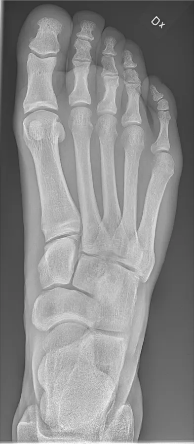

<p align="center">
  
</p>

# SkeletonMap

An educational viewer that links a labelled foot radiograph to an interactive 3D skeleton, helping people connect a flat X-ray projection with the bones it represents.

**[Live](https://ziwen-xie.github.io/SkeletonMap/)** · **[Demo](https://ziwen-xie.github.io/SkeletonMap/#/viewer)** · **[Source](https://github.com/ziwen-xie/SkeletonMap)**

Built for the **Hackachusetts Healthcare & Biotech track** with Kiro spec-driven development.



## Problem and approach

X-rays compress three-dimensional anatomy into a difficult grayscale projection. SkeletonMap places a pre-labelled radiograph beside a rotatable foot model: hover a mapped region and its 3D counterpart highlights in the same color; select it to focus the camera and read a plain-language anatomical note.

## Implemented

- Bidirectional highlighting between 19 mapped radiograph regions and individually selectable 3D bones
- Camera focus, orbit, pan, zoom, touch controls, responsive split/stacked layouts, and WebGL fallback
- Educational descriptions, common conditions, projection notes, keyboard access, and visible focus states
- Demo and upload routes with local JPEG/PNG processing; uploaded image data is neither transmitted nor persisted
- Body-region picker that clearly marks the foot as the only available map

## Current limitations

- The demo uses one pre-labelled adult right-foot dorsoplantar (DP) radiograph.
- Uploads reuse that static foot mapping. SkeletonMap does not register landmarks or adapt polygons to a different patient, pose, projection, or crop.
- JPEG and PNG display are supported; DICOM decoding is not implemented.
- There is no AI inference, diagnosis, abnormality detection, image assessment, or clinical decision support.
- The 3D foot is stylized procedural geometry, not a scan-derived or medical-grade anatomical model.

## How it works

1. Open the mapped demo or choose a local JPEG/PNG image.
2. Confirm the foot so the static region configuration and 3D model load.
3. Hover to connect 2D and 3D anatomy; click for camera focus and educational context.

## Stack

React 19 and TypeScript power the interface. React Three Fiber, Drei, and Three.js render the 3D view; Zustand owns shared interaction state; react-dropzone handles local file selection. Vite builds the site, Tailwind CSS supplies the design system, and Vitest with Testing Library covers the current automated tests.

## Architecture

- [`src/components`](src/components) — landing page, upload flow, X-ray overlay, educational panel, and 3D viewer
- [`src/stores/useSkeletonMapStore.ts`](src/stores/useSkeletonMapStore.ts) — shared mode, image, mapping, selection, and camera state
- [`src/services`](src/services) — image loading, validation, and mapping lookups
- [`src/models`](src/models) — original procedural foot geometry, camera bounds, and body silhouette
- [`public/config/foot-mapping.json`](public/config/foot-mapping.json) — polygon-to-mesh mapping and educational content
- [Requirements](.kiro/specs/bone-vision/requirements.md) · [Design and correctness properties](.kiro/specs/bone-vision/design.md) · [Task plan and dependency graph](.kiro/specs/bone-vision/tasks.md)

## Built with Kiro

SkeletonMap was developed in Kiro, an AI-powered IDE, from a requirements-first specification. Acceptance criteria shaped the system boundaries; the design recorded interfaces, data flow, error behavior, and correctness properties. The task plan organized implementation as a dependency graph, focused agents handled delegated tasks, and each completed slice was checked with relevant type, lint, test, and production-build validation.

## Local development

Requires Node.js 22 (matching the deployment workflow).

```bash
npm ci
npm run dev
```

Vite serves the app at `http://localhost:3000`.

```bash
npm run type-check
npm run lint
npm test
npm run build
```

## Deployment

[GitHub Actions](.github/workflows/deploy.yml) builds `main` and publishes `dist` to GitHub Pages after type checking, linting, and testing. Vite uses `/SkeletonMap/` as its production base, and runtime asset requests derive from `import.meta.env.BASE_URL`. The hash route keeps the viewer link functional on a static project site.

## Privacy and educational scope

Uploaded images are decoded in the browser and held only in memory. SkeletonMap has no upload server or analytics path for medical images. The application is for anatomy education only: it does not evaluate an image or provide medical advice. Discuss imaging findings, symptoms, and treatment with a qualified clinician.

## Assets and credit

“X-ray of normal right foot by dorsoplantar projection” by Mikael Häggström, via [Wikimedia Commons](https://commons.wikimedia.org/wiki/File:X-ray_of_normal_right_foot_by_dorsoplantar_projection.jpg), is available under [CC0 1.0](https://creativecommons.org/publicdomain/zero/1.0/). The demo image and landing-page crops are optimized derivatives of that source.

The procedural foot geometry, body-region silhouette, and scan/map brand icon are original project work.

## Roadmap

- Replace static polygons with image-aware anatomical registration
- Add carefully sourced, scan-derived anatomy for more body regions
- Evaluate regulated pathways separately before considering any image-analysis feature
